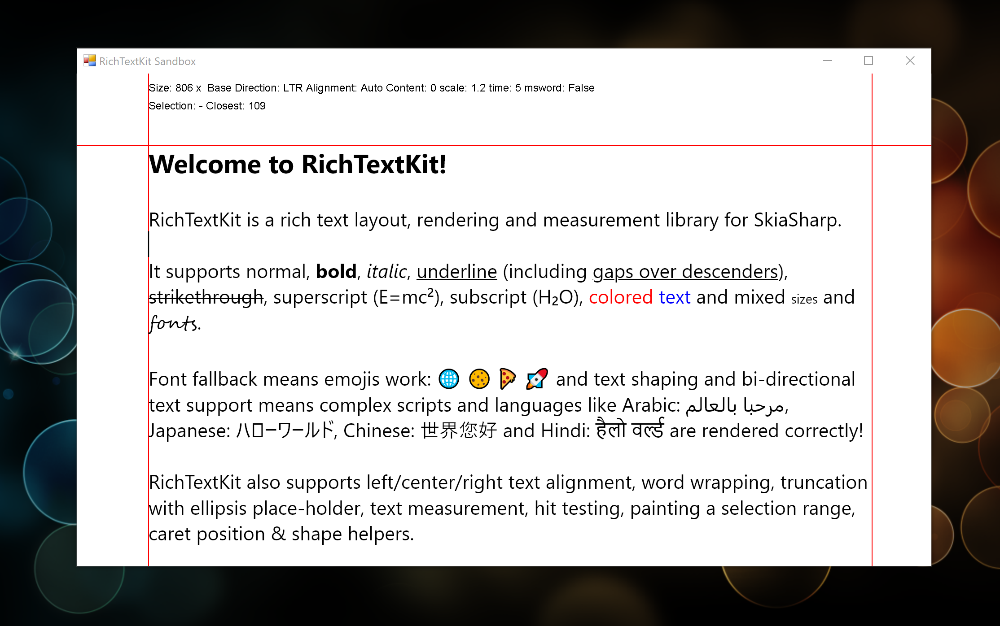

# RichTextKit

RichTextKit is a rich-text layout, measurement and rendering library for SkiaSharp.

## Features

* Rich text layout
* Supports most common font styles (bold, italic, underline, super/sub-script etc...)
* Text shaping using HarfBuzzSharp
* Font fallback for emoji and int'l character sets
* Bi-directional and LTR/RTL Text Support (UAX #9)
* Unicode word-break algorithm (UAX #14)
* Max height and max line limits
* Truncate with ellipsis support
* Text measurement support
* Hit testing and caret position information
* Ability to paint selection range highlight
* Document model for building text editors, with undo support
* Easy to use
* Minimal dependencies (just SkiaSharp and HarfBuzzSharp)



## Installation

RichTextKit is available on NuGet for `netstandard2.0` and `net8.0`:

```
dotnet add package Topten.RichTextKit
```

## Quick Start

The easiest way to get started is with the `RichString` class:

```csharp
// Build some rich text
var rs = new RichString()
    .Alignment(TextAlignment.Center)
    .FontFamily("Segoe UI")
    .MarginBottom(20)
    .Add("Welcome To RichTextKit", fontSize: 24, fontWeight: 700, fontItalic: true)
    .Paragraph().Alignment(TextAlignment.Left)
    .FontSize(18)
    .Add("This is a test string");

// Wrap and crop it
rs.MaxWidth = 640;
rs.MaxHeight = 480;

// Paint it to a SkiaSharp canvas
rs.Paint(canvas, new SKPoint(50, 50));

// Measure it
Console.WriteLine($"Size: {rs.MeasuredWidth} x {rs.MeasuredHeight}");
```

For lower-level control, use `TextBlock` to lay out and paint a single paragraph.

## Status

RichTextKit is stable and in active use.

Text layout, and Unicode and international text in particular, are complicated
topics. If you find something that doesn't lay out or render correctly, please
open an issue or a pull request.

## Release Notes

See the [changelog](https://github.com/toptensoftware/RichTextKit/blob/main/CHANGELOG.md).

## Documentation

See here for [documentation](https://www.toptensoftware.com/richtextkit).

## License

Apache 2.0. See [license.txt](https://github.com/toptensoftware/RichTextKit/blob/main/license.txt).
